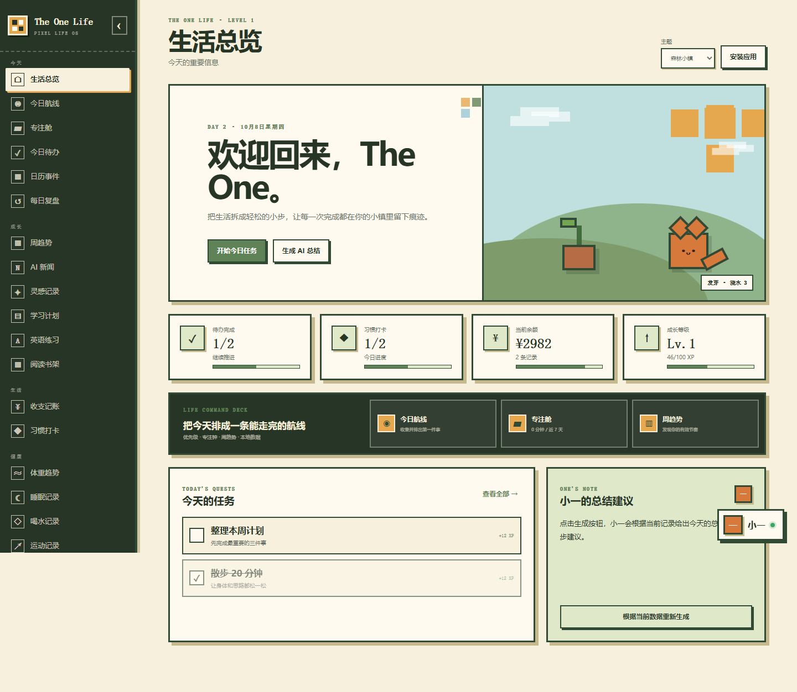

# The One Life

一套可直接使用的像素风个人生活工作台，支持电脑、Android、iPhone 与 HarmonyOS 浏览器。

> **项目状态：暂停开发，2026-10-08 整理归档。** 本次验证范围见 [验证记录](docs/VERIFICATION.md)；移动端兼容性仍需真机确认。



## 文档入口

- [项目暂停、能力边界与恢复开发](docs/ARCHIVE.md)
- [归档验证结果](docs/VERIFICATION.md)
- [原始版本记录](docs/SOURCE-HISTORY.md)
- [原 README](docs/README-original.md)
- [HarmonyOS 安装说明](HARMONYOS.md)

## 快速运行

需要 Node.js **22.13.0 或更新版本**。本次使用 pnpm 11.19.0 安装锁定依赖；依赖版本由 `pnpm-lock.yaml` 保留。个人生活记录功能不需要 API 密钥。

```sh
pnpm install --frozen-lockfile --ignore-scripts
pnpm build:static
pnpm preview:static --host 127.0.0.1 --port 4173
```

打开 `http://127.0.0.1:4173`。静态构建输出为 `dist-static/`；不要直接用文件管理器打开构建后的 HTML。

服务端开发入口为 `pnpm dev`，服务端构建为 `pnpm build`。静态构建是恢复本项目的首选入口；服务端路径的具体检查结果见验证记录。

原有检查命令：

```sh
pnpm test
node --test tests/mobile-shell.test.mjs
pnpm lint
```

`pnpm test` 会先重新构建服务端输出。原有 mobile-shell 测试主要检查代码和样式约定，不代表真机测试。

## 已实现

- 今日待办、日历、记账、AI 新闻、习惯、灵感、学习、英语、体重与复盘
- 睡眠、喝水、运动、饮食、用药、阅读、项目和家庭计划
- 本地个人相册、奖励花园、金币、经验、植物成长和固定奖励
- AI 总结建议、五维成长画像、像素角色和“小一”Agent
- 文字命令、Web Speech API 语音入口及文字降级
- 四套主题、减少动态效果、电脑侧栏和手机抽屉导航
- localStorage 自动保存、JSON 导出和导入
- PWA 清单、Service Worker、离线基础缓存和三平台安装中心

其中“AI 总结建议”和“小一”目前使用本地规则与文字命令实现，没有接入远程大模型；实时新闻依赖公开网络接口。现有界面不等于所有功能已逐项完成验收，具体范围见验证记录。

## 数据说明

所有个人数据默认保存在当前设备的当前浏览器中。刷新或重新打开页面后记录会保留，但更换设备、清理浏览器数据或卸载应用后可能丢失。应用内可以导出 JSON 备份并在另一台设备导入；当前版本不提供账号、多设备实时同步或云端备份。

个人相册会在浏览器中压缩图片并保存到 localStorage，不会主动上传至公开图床。浏览器存储空间有限，不建议放入大量高清图片。

## 安装方法

### Android

使用 Chrome、Edge 或系统浏览器打开 HTTPS 公网地址，点击页面中的“安装应用”；如果没有弹窗，打开浏览器菜单并选择“安装应用”或“添加到主屏幕”。

### iPhone

使用 Safari 打开 HTTPS 公网地址，点击“分享”，选择“添加到主屏幕”。

### HarmonyOS

使用华为浏览器打开 HTTPS 公网地址，点击“更多”，选择“添加至桌面”或浏览器提供的“安装应用”。不同系统版本的菜单名称可能略有差异。

当前交付是可安装网页应用。若要提交华为应用市场成为原生 HAP，还需要在 DevEco Studio 中封装、配置华为开发者证书、签名并通过应用市场审核。

## 本地开发

项目使用 vinext、React 和 TypeScript。安装依赖后运行 `pnpm dev`，生产构建使用 `pnpm build`。
